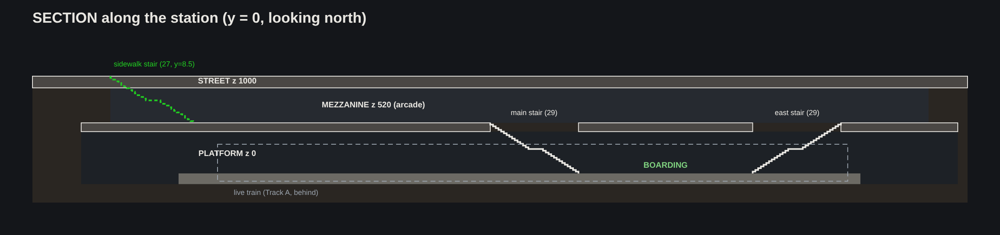

# Cortlandt Station: layout v3, "The Arcade"

Three levels: **street → mezzanine → platform**. Grounded, real-NYC reference: a Turnstyle-style underground
arcade (Columbus Circle) running directly above the island platform, with ordinary sidewalk stairs down from the street.
No set pieces through the ground. All numbers are in `core/spec.py`; the drawings in `plans/` are generated from it
(`python3 -m core.plan_svg plans`).

## What changed from the current build

| Current build | v3 |
|---|---|
| Street: huge empty plaza with the entrance lost in the middle | Normal NYC block. The green-railed sidewalk stair sits against the building line beside a corner store, as in real life |
| Mezz: dark corridor, cages, trench down the middle | **One straight, bright arcade**: glass shopfronts both sides, white riveted columns, a line of glass display kiosks down the centre |
| No centre of gravity | **The Node**: the crossroads mid-arcade with the main stair down, the raid board and a compass-rose floor. Everything important is within 15 m of it |
| Platform: board and leave | Route board at the lead cab, and a test range down the Track B tunnel (reuses the range kit) |

## Level 1: Street (z 1000), danger zone and tutorial

- **Greenwich St** runs east–west over the station, crossed by **Cortlandt St** (x −60) and **Dey St** (x +60). Barricade ring at x ±95, y ±58.
- **Entrances** are real sidewalk stairs (2 m wide, green railings, globe lamps on the newel posts) along the building line:
  - **North, green globes:** open; the main way in, right beside **Cortlandt Drugs** / the corner news-grocery.
  - **South, red globes:** welded shut; a landmark you can see from inside the Gate.
- **Tutorial path:** START at the overrun NYPD checkpoint (west end) → Cortlandt St intersection → Cortlandt Drugs (first loot) → green stair → down. About 60 m.
- **Pocket plaza** (36 × 35 m, NE of centre): an overrun FEMA tent camp. Replaces the current giant plaza.
- 84 storefronts in 15 m-deep lots, **18 enterable interiors**, **3 walk-ups** on the cross streets.
- Zombie fence and 12 spawners outside the barricade; the Tide breaks in at telegraphed gaps.

## Level 2: Mezzanine (z 520), the safe hub

84 × 24 m, clear height 3.6 m. An 8 m-wide concourse runs the whole length, directly above the platform.

**Flow.** Street stairs land in the **Gate**. Pass the watch post and the turnstiles into the **Market**, then reach the **Node**.
- The four most-used services (trade post, infirmary, gunsmith, stash) are the bays directly beside the Node.
- Less frequent stops sit in the outer bays.
- Bunks are next to the stash, so you wake, gear up, and are at the raid board in about 15 s.

| Room | Was | Now | Light identity |
|---|---|---|---|
| Gate | Unpaid area | Street stairs land here; defensive airlock | Sodium orange, CCTV glow |
| Watch post | Token booth | Sandbagged, CCTV wall, alarm | Red alarm lamp |
| Turnstiles + shutter | Fare line | Card-gated; rolling shutter drops during the Tide | — |
| Market | Concourse kiosks | Glass display islands down the centre line | Kiosk under-lights |
| Mechanic | Locksmith | Gear, keys, crafting parts | Orange caged bulbs |
| Trade post | Newsstand | Trader NPC: buy/sell | Warm marquee bulbs |
| **The Node** | Crossroads | **Main stair down**, **raid board** (north wall), compass-rose floor, co-op muster | Bright overhead light boxes |
| Gunsmith | Shoe repair | Weapons, mods, repair | Red neon |
| Workshop | Phone repair | Crafting bench, 3D printer | Cool white + printer glow |
| Galley | Pizza counter | Food buffs, social corner near the entrance | String lights |
| Infirmary | Pharmacy | Medic NPC, heal | Clinical white |
| Stash | Lost & found | Lockers, recovery locker | Cool fluorescent |
| Bunks | Crew storage | Respawn (4 bunks) | Dim red night lamps |
| Black market | Signal room | Behind the NO ENTRY staff door; quest unlock | UV purple |
| Generator | Fan plant | Powers the hub; cable runs along the ceiling | Hazard amber |

**Platform stairs** are floor openings in the concourse with railings on three sides and tactile strips (reference photo 3):
- **Main stair** at the Node: 3 m wide, descends east.
- **East stair** at the far end: 2.4 m wide, descends west.

## Level 3: Platform (z 0), the way out

- 70 × 9 m island platform, I-beam columns every 15 ft in two rows.
- **Track A (south):** live train, 4 cars. **Boarding** happens between the two stair feet, and the **route board** at the lead cab is where you pick a stop.
- **Track B (north):** 3 derelict cars, then the **test range**: steps down to the trackbed at the east end, with targets at 10/25/50 m.
- Both tunnel mouths fade to black, which hides the "ride the line" loading screen.

## Vertical rules
- Street → mezz: 27 risers (17.8 cm), 0.28 m treads, 1.5 m mid landing. Mezz → platform: 29 risers (17.9 cm).
- Slabs: platform ceiling 4.3, mezz floor 5.2, mezz ceiling 8.8, street 10.0.
- The concourse sits directly over the platform, so both platform stairs drop straight down the centre line.

## Reuse from the current build
Brick facades, storefront and sign kit, cars, traffic lights, subway tile + green trim, I-beam columns (paint them white
and riveted for the arcade), train cars, platform edge strip, sandbags, chain-link, pendant lamps, range targets.
**Only the layout changes.**

## Open questions for the build doc
1. Should shop bays be wider than 12 m so 4 co-op players fit at the trader at once?
2. Is the black market a quest unlock or always open?
3. Does the red entrance ever open?
