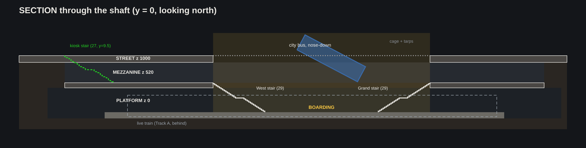
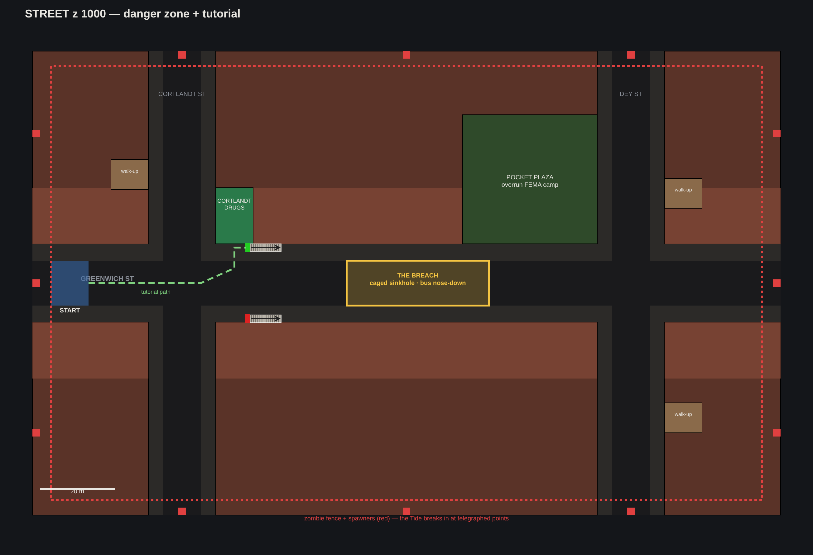
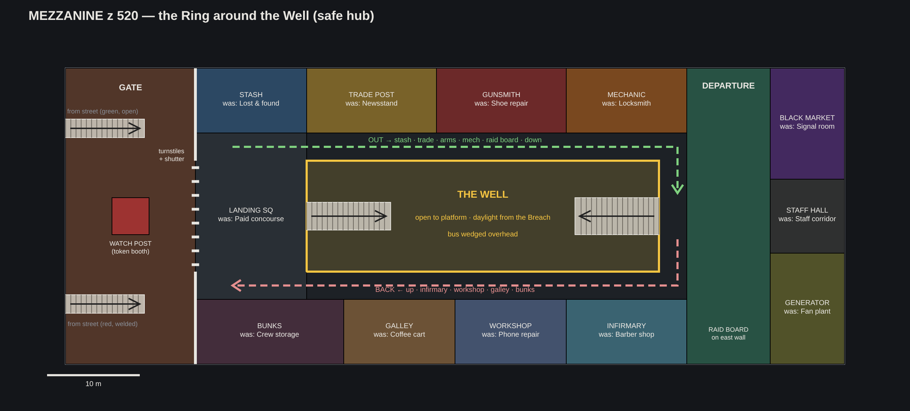
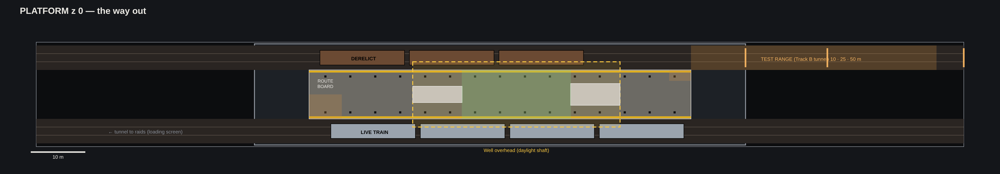

# Cortlandt Station: layout v2, "The Well"

Same three levels: **street → mezzanine → platform**. New organizing idea: **one vertical shaft through all three.**
A sinkhole in Greenwich St (the Breach) drops onto an open atrium in the mezzanine (the Well), which opens onto the
boarding area of the platform. Daylight falls three storeys onto the live train.
All numbers live in `core/spec.py`; the drawings in `plans/` are generated from it (`python3 -m core.plan_svg plans`).

## Why change it (v1 problems → v2 fix)

| v1 (current build) | v2 |
|---|---|
| Street: huge empty plaza, small entrance lost in the middle, no path | Tight street with one guided tutorial path; the green kiosk is visible from the first intersection; the Breach is the landmark |
| Mezz: one long dark corridor, cages on both sides, trench in the middle | A **ring** around the Well. Every service faces inward, so you can see every shop from anywhere |
| Train invisible from the hub | You look down the Well onto the train roof from every walkway. The goal is always on screen |
| Dark everywhere, flat | Daylight shaft + one light colour per service, which gives a readable map at a glance |
| Platform: board and leave | Route board at the lead cab, plus a **test range** down the Track B tunnel (reuses the shooting-range kit) |

## Level 1: Street (z 1000), danger zone and tutorial

- **Greenwich St** runs east–west above the station, crossed by **Cortlandt St** (x −60) and **Dey St** (x +60). Barricade ring at x ±95, y ±58.
- **Tutorial path:** START at the overrun NYPD checkpoint (west end) → Cortlandt St intersection → **Cortlandt Drugs**
  (NW corner, first loot) → **green-globe kiosk** right beside it → down. About 60 m. Zombies trickle in behind you.
- **The Breach** (38 × 12 m, the full avenue width): the roadway collapsed into the mezzanine. A city bus hangs
  nose-down in it, caught by a welded rebar cage with tarps. From the street it's the landmark; from below it's the hub's skylight.
- **Red-globe kiosk** (south sidewalk) is welded shut. It's visible from inside the gate, and opens as late-game progression or an emergency exit.
- **Pocket plaza** (NE of centre, 36 × 35 m): an overrun FEMA tent camp, which tells the outbreak story. It replaces v1's giant plaza.
- **3 walk-ups** on the cross streets (one near START), **18 enterable interiors**, **84 storefronts** in 15 m-deep lots along every face.
- **Zombie fence + 12 spawners** outside the barricade. The Tide breaks in at telegraphed gaps and herds players toward the kiosk.

## Level 2: Mezzanine (z 520), the safe hub

84 × 32 m, clear height 3.6 m. Entry from the street lands in the **Gate**; the **fare line is the defence line**.

**The loop** (about 120 m, roughly 25 s at walk speed):
- **Out** along the north walkway: stash → trade post → gunsmith → mechanic → raid board → Grand Stair down.
- **Back** along the south walkway: up the Grand Stair → infirmary → workshop → galley → bunks.

You come back hurt, so the infirmary is the first door at the top of the stairs. You leave geared, so the raid board is the last thing before the stairs down.

| Room | Was | Now | Light identity |
|---|---|---|---|
| Gate | Unpaid area | Street stairs land here; airlock | Sodium orange, CCTV glow |
| Watch post | Token booth | Sandbagged, CCTV wall, alarm | Red alarm lamp |
| Turnstiles + shutter | Fare line | Card-gated; rolling shutter drops during the Tide | — |
| Landing square | Paid concourse | First safe space, Well edge, west stair | Work lights |
| Stash | Lost & found | Lockers, recovery locker | Cool fluorescent |
| Trade post | Newsstand | Trader NPC: buy/sell | Warm marquee bulbs |
| Gunsmith | Shoe repair | Arms: weapons, mods, repair | Red neon |
| Mechanic | Locksmith | Gear, keys, crafting parts | Orange caged bulbs |
| Departure | Exit passage | **Raid board** (east wall), map table, co-op muster | Projector on the board |
| Infirmary | Barber shop | Medic NPC, heal | Clinical white + barber pole |
| Workshop | Phone repair | Crafting bench, **3D printer** | Cool white + printer glow |
| Galley | Coffee cart | Food buffs, market stalls along the walkway | String lights |
| Bunks | Crew storage | Respawn (4 bunks), wake-up point | Dim red night lamps |
| Black market | Signal room | Hidden behind the staff door; quest-unlocked | UV purple |
| Generator | Fan plant | Powers the hub; cable runs lead the eye along the ceiling | Hazard amber |

**The Well** (38 × 12 m) has a tiled parapet (reuse v1's green-trim subway-tile parapet) and two stairs going down
*inside* it: **West Stair** (3 m wide, near the bunks) and the **Grand Stair** (4 m, at Departure). Both are 29 risers with a mid landing.

## Level 3: Platform (z 0), the way out

- 70 × 9 m island platform, I-beam columns every 15 ft. Under the Well the columns run double-height up to the street slab.
- **Track A (south):** live train, 4 cars. **Boarding zone** sits under the daylight shaft; the **route board** at the lead cab is where you pick a stop.
- **Track B (north):** 3 derelict cars, then the **test range**: steps down to the trackbed at the east end, with targets at 10/25/50 m in the tunnel.
  It's a natural home for the existing range assets.
- Both tunnel mouths fade to black, which hides the "ride the line" loading screen.

## Vertical rules
- Street → mezz: 27 risers (17.8 cm), 0.28 m treads, 1.5 m mid landing. Mezz → platform: 29 risers (17.9 cm).
- Slabs: platform ceiling 4.3, mezz floor 5.2, mezz ceiling 8.8, street 10.0.
- The shaft rect `WELL = (-16, -6, 22, 6)` is identical on all three levels. Keep it that way; it is the level's spine.

## Reuse from the current build
Brick facades, storefront and sign kit, cars, traffic lights, subway tile + green trim, I-beam columns, R-type train cars,
platform edge strip, sandbags, chain-link, pendant lamps, range targets. **Only the layout changes; the art kit carries over.**

## Open questions for the build doc
1. Does the hub need room for 4 players' NPC interaction at once (queueing at the trader)? If yes, widen the Row shops to 16 m.
2. Is the black market a quest unlock or always open?
3. Should the red kiosk ever open (shortcut late game), or stay a landmark only?
