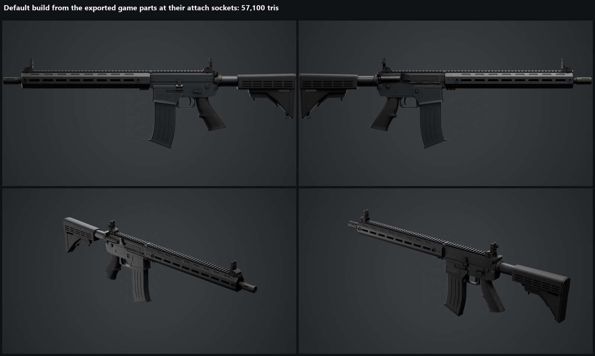
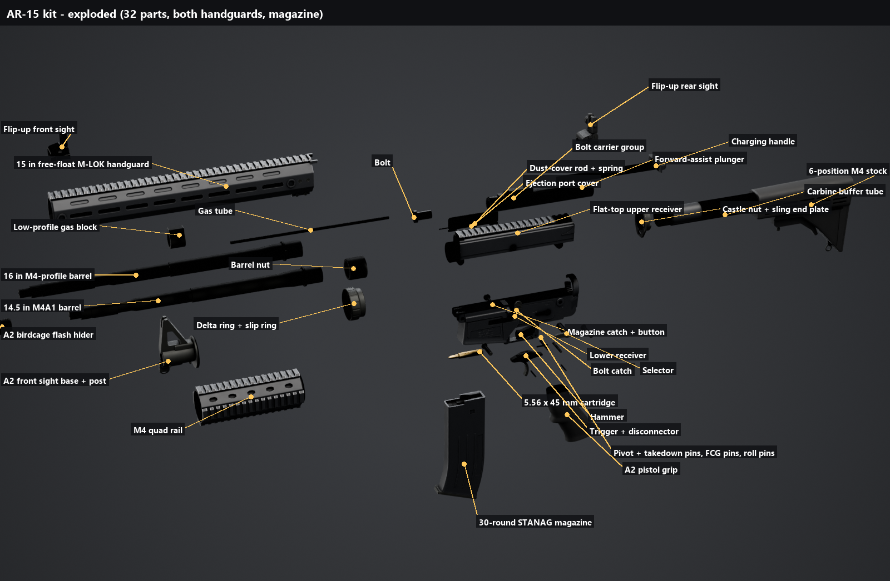

# AR-15

A modular AR-15 kit: one lower and upper that take either barrel (16 in M4 profile or 14.5 in M4A1), either handguard (15 in free-float M-LOK or M4 quad rail), an A2 birdcage, flip-up sights (deployed or stowed) and a 30-round STANAG magazine (empty or loaded). The default build is 57,100 triangles.

- `fbx/`: the game meshes. Each attaches to the lower at its socket. `SM_AR15_UpperBody` + `SM_AR15_BCG` are the upper split so the bolt carrier can cycle.
- `fbx/lod/`: LOD1 and LOD2 for every game mesh.
- `parts/`: the loose 32-part kit from the exploded view (receivers, bolt, carrier, pins, springs, sights...).
- `textures/`: AO, curvature, normal and mask atlases per material family (Receiver, Steel, BCG, Polymer, handguards). [`MATERIALS.md`](MATERIALS.md) explains the slots; [`game_parts.json`](game_parts.json) maps each mesh slot to its atlas.
- `sockets/`: attach points per mesh.
- `scripts/`: the Blender Python that builds, bakes, splits and exports the kit (`build_ar15.py` drives it; `ar15_spec.py` holds the dimensions). The scripts expect the original project's folder layout and are here for reference.
