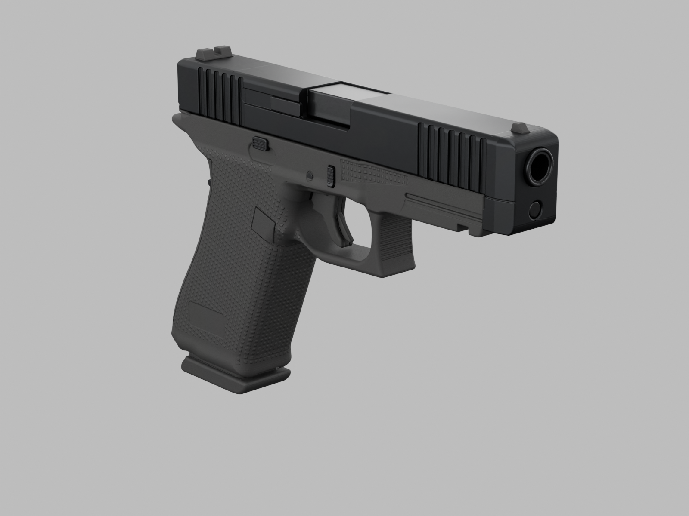
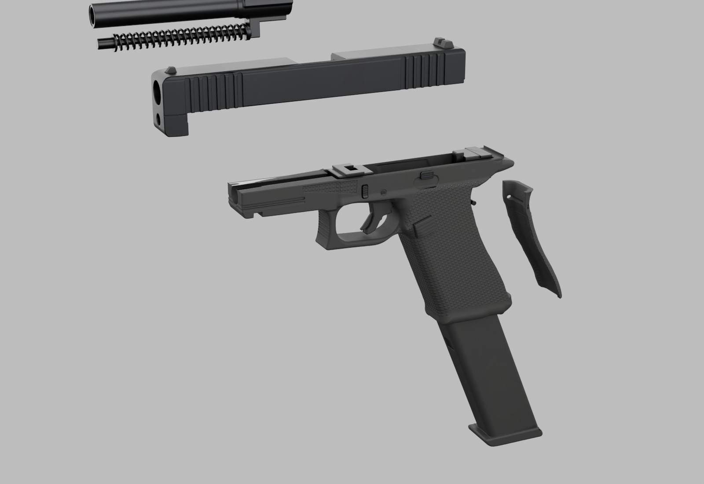

# Glock 17 Gen 5

Five game meshes split for animation: frame, slide, barrel (with recoil spring assembly), magazine and backstrap. The textures were baked from a separate high-poly model.

- `fbx/`: game meshes; `fbx/lod/`: LOD1 and LOD2.
- `textures/`: `T_G17_<Part>_{BaseColor,Normal,ORM}` (Frame and Slide are 4K, the rest 2K). OpenGL normals.
- `sockets/G17_sockets.json`: attach sockets.
- `scripts/`: the Blender Python pipeline (`bl_high.py` high poly, `bl_low.py` game mesh, `bake.py` bakes and LODs, `export.py` FBX). It expects the original project's folder layout and is here for reference.
