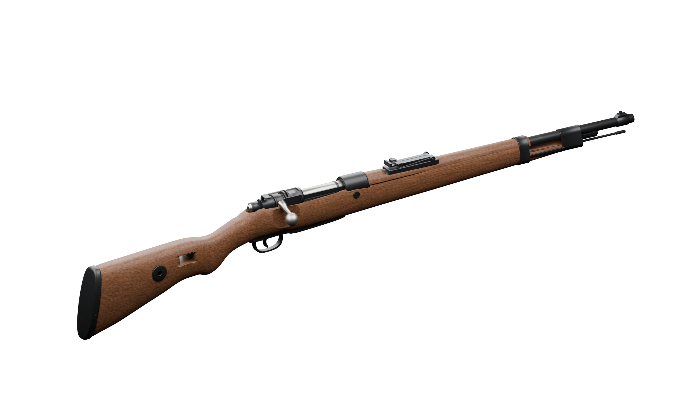

# Kar98k

The full rifle, a body without the bolt (`SM_Kar98k_BoltBody`) and the bolt (`SM_Kar98k_Bolt`), so the bolt-action cycle animates.

- `fbx/`: game meshes; `fbx/lod/`: LOD1 and LOD2 for each.
- `textures/`: `T_Kar98k_{Metal,Wood}_{BaseColor,Normal,ORM}`, 4K. OpenGL normals.
