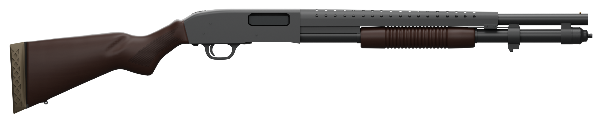
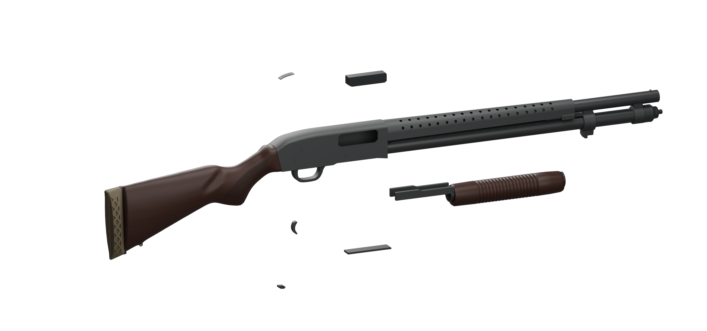

# Mossberg 590

A 20 in (508 mm) Mossberg 590 with a heat shield and a walnut stock and ribbed walnut pump. It comes as the full gun with the pump at rest, a body without the fore-end, and the moving parts the reload and pump animations use.

- `fbx/`: `SM_M590` (full), `SM_M590_Body` (without the fore-end), `SM_M590_Pump` (fore-end, slide tube and action bars; pivot on the bore axis), plus `Frame`, `Bolt`, `Elevator`, `Trigger`, `Safety` and `ActionRelease`.
- `textures/`: `T_M590_{BaseColor,Normal,ORM}`, 4K. OpenGL normals.
- `sockets/sockets.json`: attach sockets.
