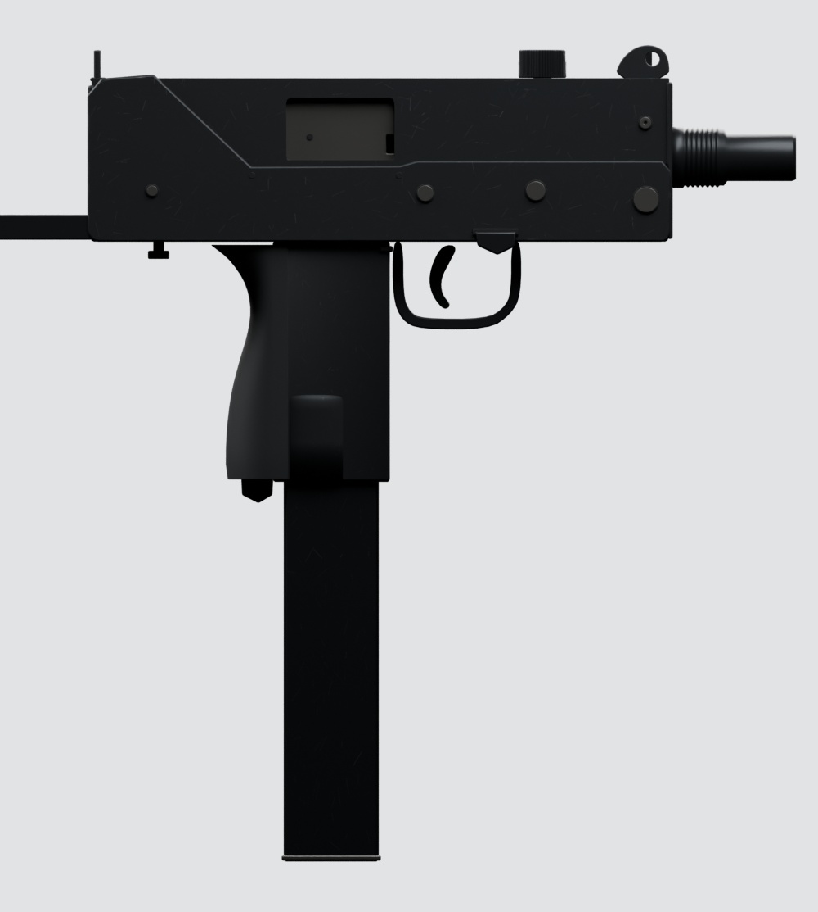
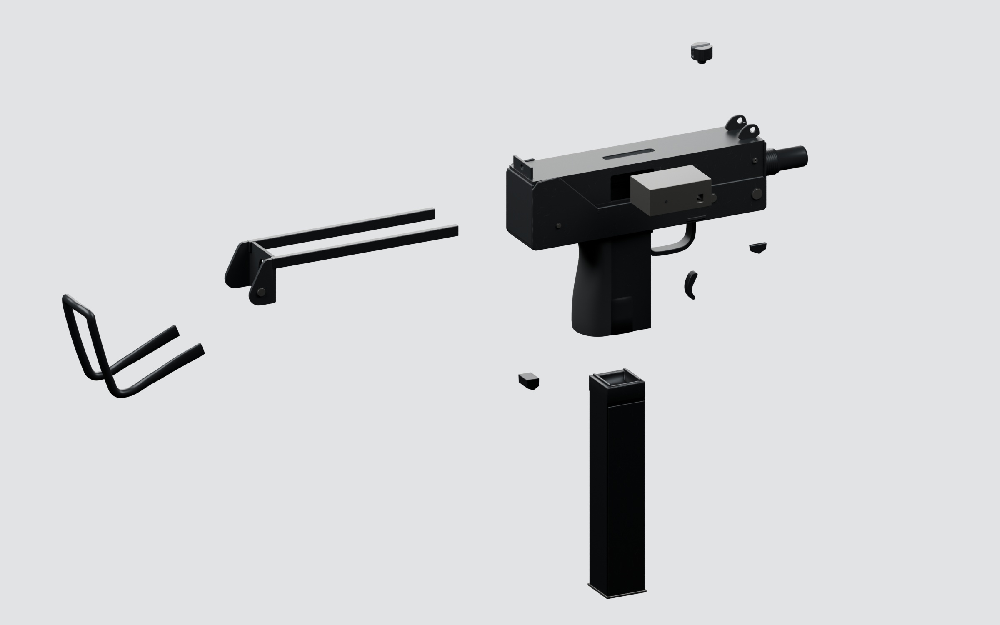

# MAC-10

The full gun, plus a body without the bolt (`SM_MAC10_PumpBody`), the bolt itself (`SM_MAC10_Pump`, named for the game's shared sliding-part slot) and the magazine.

- `fbx/`: game meshes; `fbx/lod/`: LOD1 and LOD2 of the full gun and the magazine.
- `textures/`: `T_MAC10_{Body,Stock,Magazine}_{BaseColor,Normal,ORM}` (Body 4K, Stock and Magazine 2K). OpenGL normals.
